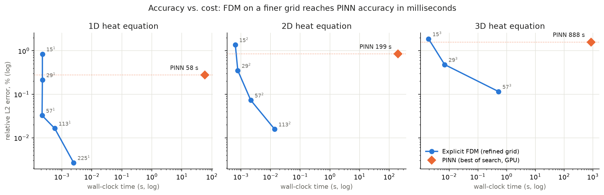
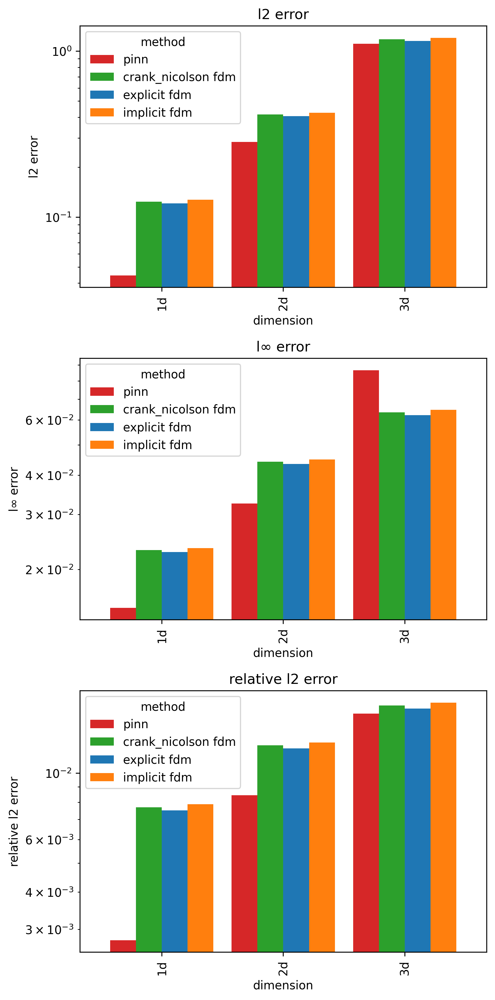

# PINN vs FDM: Heat Equation Benchmark

[](https://github.com/abhinaash-broski/pinn-heat-equation-benchmark/actions/workflows/validate.yml)

A controlled comparison of Physics-Informed Neural Networks (PINNs) and three finite-difference schemes (explicit, implicit, Crank–Nicolson) on the 1D, 2D and 3D heat equation, scored against an exact Fourier-series solution. Final Year Project (MATH 499), B.Sc. Computational Mathematics.

**Key findings**

1. **On a matched 15-node-per-axis grid, the tuned PINN is more accurate than all three FDM schemes**: 0.28% vs 0.75% relative L2 error in 1D, 0.85% vs 1.21% in 2D, and 1.58% vs 1.65% in 3D.
2. **At matched *accuracy*, FDM wins by about five orders of magnitude.** If you refine the FDM grid from 15 to 29 nodes per axis, it beats the PINN in every dimension in under 10 ms. The PINN needed 1–15 minutes of GPU training to get there ([details](#accuracy-vs-cost-the-fair-comparison)).
3. For a smooth, linear problem on a box, the PINN's advantage in (1) comes from the coarse grid, not from the method. The case for PINNs is elsewhere: inverse problems, irregular geometry, sparse or noisy data, and very high dimensions.

Every number in this README can be checked on a laptop CPU in about 5 seconds; see [Verify the results](#verify-the-results).



---

## Table of Contents

- [Verify the results](#verify-the-results)
- [Problem setup](#problem-setup)
- [Methods](#methods)
- [PINN architecture & training](#pinn-architecture--training)
- [Results](#results)
- [Accuracy vs cost: the fair comparison](#accuracy-vs-cost-the-fair-comparison)
- [Known issues & threats to validity](#known-issues--threats-to-validity)
- [Repository layout](#repository-layout)
- [References](#references)

---

## Verify the results

```bash
git clone https://github.com/abhinaash-broski/pinn-heat-equation-benchmark.git
cd pinn-heat-equation-benchmark
pip install -r requirements.txt   # numpy, pandas, matplotlib only
python validate.py
```

The same check runs in CI on every push (Python 3.10 and 3.12), which is what the badge above reports.

[validate.py](validate.py) uses only the committed CSVs in [computed-solutions/](computed-solutions/) and runs on a CPU. It:

- recomputes every relative L2 / L∞ error in the results table and **exits non-zero if any value differs from this README**;
- rebuilds the ground truth independently. The initial condition is a product of 1D triangles, so the 2D/3D solution is a product of 1D series. This gives a 4,001-term reference in milliseconds. The committed N=50 analytical CSVs agree with it to a relative error of about 1e-5, so they are a valid ground truth;
- scores a do-nothing baseline (u = u₀) so the errors have context;
- runs the grid-refinement study and regenerates `plots/accuracy_vs_cost.png`.

Re-running the full pipeline (analytical + FDM + PINN training) requires [eopfsp.ipynb](eopfsp.ipynb), `pip install -r requirements-notebook.txt`, and a CUDA GPU. 3D training needs about 4.5 GB of VRAM. The notebook was run on Kaggle (Tesla P100-16GB) and reads from `/kaggle/input/computed-solutions`. Change `input_dir` in cell 4 to run it elsewhere.

---

## Problem setup

**Governing equation** (heat diffusion in copper):

$$\frac{\partial u}{\partial t} = \alpha \nabla^2 u, \qquad \alpha = 1.1644 \times 10^{-4}\ \text{m}^2/\text{s}$$

**Initial condition:** a triangular profile. It is extended as a product for 2D/3D, e.g. $u_0(x,y) = \text{tri}(x)\,\text{tri}(y)$:

$$\text{tri}(x) = \begin{cases} 2x/L & x \leq L/2 \\ 2(L-x)/L & x > L/2 \end{cases}$$

**Boundary conditions:** homogeneous Dirichlet, $u = 0$ on all faces.

**Domain:** $[0,1]^n$, $t \in [0, 60]$ s. Errors are evaluated on a $15^n$ spatial grid ($dx = 1/14$) at $t = 1, 2, \dots, 60$ s.

The solution is not trivial over this window. Diffusion smooths the kink, and the peak drops to 0.81 (1D), 0.66 (2D) and 0.53 (3D). A model that ignores time and outputs $u_0$ scores 7.2% / 12.5% / 17.8% relative L2 error.

| Dimension | Spatial grid | Evaluation points (×60 times) |
|-----------|--------------|-------------------------------|
| 1D | 15 | 900 |
| 2D | 15×15 | 13,500 |
| 3D | 15×15×15 | 202,500 |

---

## Methods

- **Analytical:** Fourier sine series, N = 50 terms per axis. Used as ground truth and independently verified (see above).
- **Explicit FDM:** forward Euler, second-order central differences.
- **Implicit FDM:** backward Euler, sparse direct solve (`scipy.sparse.linalg.spsolve`).
- **Crank–Nicolson FDM:** θ = 0.5, sparse direct solve.
- **PINN:** a fully connected network $u_\theta(x, t)$ trained on PDE, BC and IC residuals.

All FDM schemes use dt = 0.6 s (100 steps). The explicit stability number $\sum_i \alpha\,dt/dx_i^2$ is 0.0137 / 0.0274 / 0.0411 for 1D / 2D / 3D, far below the 0.5 limit. Because of this, spatial error dominates the FDM results, so the three schemes give nearly identical accuracy.

PINN collocation points come from Latin Hypercube Sampling. PDE points are resampled every 100 epochs.

| Dimension | PDE points | BC points | IC points |
|-----------|-----------|-----------|-----------|
| 1D | 3,000 | 1,000 | 2,000 |
| 2D | 30,000 | 10,000 | 20,000 |
| 3D | 60,000 | 20,000 | 40,000 |

---

## PINN architecture & training

**Loss:** $\mathcal{L} = w_\text{PDE}\,\mathcal{L}_\text{PDE} + w_\text{BC}\,\mathcal{L}_\text{BC} + w_\text{IC}\,\mathcal{L}_\text{IC}$. Three weighting schemes are implemented:

- `equal`: all weights are 1.
- `adaptive_gradnorm`: inverse gradient-norm balancing, with an exponential moving average of each term's gradient norm and per-dimension clamping ranges. The name follows the notebook. It is not the GradNorm algorithm of Chen et al. (2018).
- `adaptive_lr_annealing`: loss-ratio weighting, plus an exponential LR decay (γ = 0.99 per epoch) that only this scheme uses.

**Search space:** a grid of 864 configurations over depth, width, activation (tanh / GELU / SiLU / Mish), learning rate (5e-3, 5e-4), optimizer (Adam, Adam→L-BFGS at 90%), initialization (Xavier, Kaiming) and loss weighting. Training ran for 6,000 epochs, with an abort if the loss exceeded 16 after epoch 400. The weights with the lowest training loss are restored at the end.

**Selected configuration per dimension** (re-run in notebook cells 38–40):

| Dim | Depth | Width | Activation | LR | Optimizer | Loss weighting | Init | Train time (s) | Peak GPU mem (MB) |
|-----|-------|-------|------------|-----|-----------|----------------|------|----------------|-------------------|
| 1D | 2 | 8 | tanh | 5×10⁻³ | Adam | adaptive_gradnorm | Kaiming | 58.2 | 67 |
| 2D | 6 | 64 | tanh | 5×10⁻⁴ | Adam | adaptive_gradnorm | Xavier | 199.2 | 919 |
| 3D | 6 | 128 | tanh | 5×10⁻⁴ | Adam | adaptive_gradnorm | Xavier | 888.3 | 4,503 |

All three selected runs use a constant learning rate, with no decay. Train times come from the committed result files; separate runs vary by about 5%.

**Final training losses:**

| Dim | PDE | BC | IC | Total (weighted) |
|-----|-----|----|----|------------------|
| 1D | 2.17×10⁻⁸ | 7.78×10⁻⁷ | 3.11×10⁻⁵ | 3.31×10⁻⁵ |
| 2D | 3.34×10⁻⁸ | 7.07×10⁻⁶ | 2.73×10⁻⁵ | 4.79×10⁻⁵ |
| 3D | 1.81×10⁻⁸ | 1.40×10⁻⁵ | 4.30×10⁻⁵ | 3.94×10⁻⁵ (best epoch) |

The IC loss dominates in every case. The remaining error sits at the kink of the initial condition, which a smooth tanh network struggles to represent.

---

## Results

Errors are measured on the 15ⁿ grid × 60 time levels, against the exact solution. Every row is reproduced by `validate.py`.

| Dim | Method | Rel. L2 error (%) | L∞ error | Time (s) |
|-----|--------|------------------|----------|----------|
| **1D** | Explicit FDM | 0.751 | 0.0228 | 0.003 |
| | Implicit FDM | 0.788 | 0.0234 | 0.016 |
| | Crank–Nicolson | 0.770 | 0.0231 | 0.009 |
| | **PINN** | **0.276** | **0.0151** | 58.2 (GPU training) |
| **2D** | Explicit FDM | 1.212 | 0.0435 | 0.005 |
| | Implicit FDM | 1.268 | 0.0449 | 0.039 |
| | Crank–Nicolson | 1.240 | 0.0442 | 0.040 |
| | **PINN** | **0.845** | **0.0325** | 199.2 (GPU training) |
| **3D** | Explicit FDM | 1.646 | **0.0622** | 0.010 |
| | Implicit FDM | 1.723 | 0.0646 | 2.47 |
| | Crank–Nicolson | 1.685 | 0.0635 | 2.40 |
| | **PINN** | **1.583** | 0.0866 | 888.3 (GPU training) |
| ref. | u = u₀ (no dynamics) | 7.20 / 12.48 / 17.76 | — | — |

On this fixed grid, the PINN has 2.7× (1D) and 1.4× (2D) lower relative L2 error than the best FDM scheme, and is roughly tied in 3D, where its worst-case (L∞) error is higher. It costs 21,000–86,000× more wall-clock time. That is GPU training time vs single-threaded CPU time, so the ratio is indicative, not exact.



---

## Accuracy vs cost: the fair comparison

The table above holds the grid fixed, which caps FDM at its 15-node discretization error. The fairer question is how much compute each method needs to reach a given accuracy. `validate.py` answers it with explicit FDM on refined grids. Each grid is time-aligned and sampled at the same 15ⁿ evaluation points.

| Dim | FDM grid | FDM rel. L2 (%) | FDM time (s) | PINN rel. L2 (%) | PINN time (s) |
|-----|----------|-----------------|--------------|------------------|---------------|
| 1D | 29 | 0.214 | < 0.001 | 0.276 | 58 |
| 1D | 57 | 0.033 | < 0.001 | | |
| 2D | 29² | 0.351 | < 0.001 | 0.845 | 199 |
| 2D | 113² | 0.016 | 0.014 | | |
| 3D | 29³ | 0.481 | 0.007 | 1.583 | 888 |
| 3D | 57³ | 0.116 | 0.53 | | |

Doubling the FDM resolution is enough to beat the best PINN from the 864-configuration search, in every dimension, about 10⁵× faster. FDM also converges at its expected O(dx²) rate: error falls about 4× per halving of dx. The PINN gives no such guarantee.

The notebook also compares "FDM space-time nodes" with "PINN collocation points" (15³ × 100 = 337,500 vs 120,000 in 3D). This README no longer uses that comparison as an efficiency claim, for two reasons. The PINN resamples its PDE points every 100 epochs, so it sees about 3.6 M distinct points over training, and it evaluates them 6,000 times. And a 29³ FDM grid, which is cheaper still, is already more accurate.

---

## Known issues & threats to validity

A self-review of the notebook. None of these issues changes the findings above, but a careful reader should know about them.

1. **Test-set model selection.** Hyperparameters were chosen by error against the analytical solution on the same grid that is reported. With 864 candidates, the PINN numbers are therefore optimistic. A clean protocol would select on held-out points or times, or on PDE-residual loss alone.
2. **Single seed.** Each configuration was trained with seed 42 only, so there are no error bars. The 3D gap between PINN and FDM (1.58% vs 1.65%) is small enough that seed variance could reverse it.
3. **FDM time-sampling offset.** Notebook cell 8 maps eval time *t* to step `round(t/0.6)`, but cell 24 stores the state after step *i* + 1. The FDM rows labelled *t* = 1, 2, 3 s are therefore really *t* = 1.8, 2.4, 3.6 s, a mean offset of +0.59 s. `validate.py` confirms this and re-runs FDM with dt dividing 1 s. The corrected 15-node errors are slightly *higher* (0.84% / 1.37% / 1.87%), so the bug flattered FDM a little, and the PINN-vs-FDM ranking at 15 nodes stands.
4. **The search over loss weightings is confounded.** `adaptive_lr_annealing` is the only scheme with LR decay (γ = 0.99 per epoch). That leaves the learning rate at 0.1% of its initial value by epoch 700, so those runs effectively stopped training early. Adam→L-BFGS runs also used weight decay 1e-4, which Adam-only runs did not. The conclusions "gradnorm is best" and "L-BFGS does not help" are therefore not clean comparisons.
5. **Cost is measured on different hardware.** PINN time is GPU training; FDM time is single-threaded CPU. FDM memory is reported as the size of the solution array only.
6. **Axis labels in the 2D/3D CSVs.** `np.meshgrid` defaults to `indexing='xy'`, so the `x` and `y` columns in the analytical and FDM 2D/3D CSVs are swapped relative to the array indices. The solution is symmetric under x↔y, so no error value is affected. With a non-symmetric initial condition this would be a real bug; `indexing='ij'` fixes it.
7. **Analytical solver cost.** The notebook evaluates the 3D series as a triple sum over 50³ terms, which took 23 minutes. Because the problem is separable, the same solution is a product of three 1D series and takes milliseconds (`validate.py`).
8. **Run-to-run timing drift.** The notebook's saved outputs come from a different run than the committed CSVs; for example, 1D PINN time is 63.7 s in the notebook and 58.2 s in the CSV. Errors are identical across runs because training is deterministic. This README uses the committed CSVs throughout.
9. **The 864-config tuning log is not in the repository.** Cell 36, which runs the full search, is commented out, and `pinn_tuning_results.csv` is not committed. Only the three selected configurations can be reproduced from this repo.
10. **Only the unit hypercube with Dirichlet BCs is supported.** Irregular geometries and other boundary types are untested.

---

## Repository layout

```
eopfsp.ipynb              Full pipeline: analytical, FDM, PINN search & training, evaluation (Kaggle GPU)
validate.py               CPU-only verification of every reported number + accuracy-vs-cost study
requirements.txt          Dependencies for validate.py (numpy, pandas, matplotlib)
requirements-notebook.txt Additional dependencies for re-running the notebook (torch, scipy, ...)
.github/workflows/        CI: runs validate.py on every push
computed-solutions/       Committed outputs: analytical, FDM and best-PINN solutions; FDM timings
plots/                    Figures from the notebook, plus accuracy_vs_cost.png from validate.py
```

---

## References

- M. Raissi, P. Perdikaris, G. E. Karniadakis. *Physics Informed Deep Learning (Part I): Data-driven Solutions of Nonlinear Partial Differential Equations.* 2017. [arXiv:1711.10561](https://arxiv.org/abs/1711.10561)
- S. Wang, Y. Teng, P. Perdikaris. *Understanding and mitigating gradient flow pathologies in physics-informed neural networks.* SIAM J. Sci. Comput. 43 (2021). [arXiv:2001.04536](https://arxiv.org/abs/2001.04536)
- Z. Chen, V. Badrinarayanan, C.-Y. Lee, A. Rabinovich. *GradNorm: Gradient normalization for adaptive loss balancing in deep multitask networks.* ICML 2018. [arXiv:1711.02257](https://arxiv.org/abs/1711.02257)
- T. G. Grossmann, U. J. Komorowska, J. Latz, C.-B. Schönlieb. *Can physics-informed neural networks beat the finite element method?* IMA J. Appl. Math. (2024). [arXiv:2302.04107](https://arxiv.org/abs/2302.04107)
